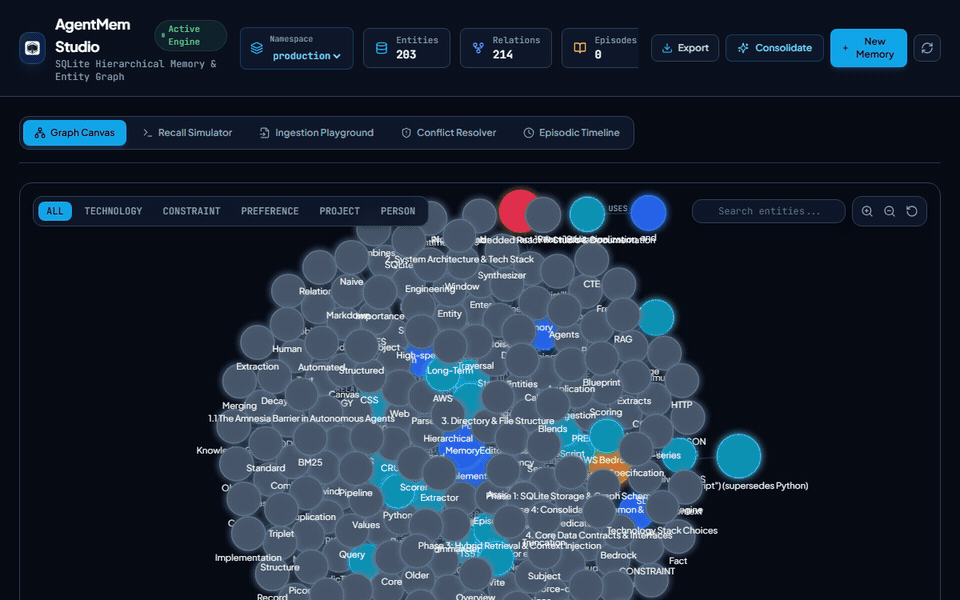

<p align="center">
  
</p>

<h1 align="center">AgentMem</h1>

<p align="center">
  Hierarchical long-term memory engine, entity knowledge graph, and visual memory inspector for autonomous AI agents.
</p>

<p align="center">
  
</p>

<p align="center">
  <a href="#overview">Overview</a> •
  <a href="#core-architecture">Architecture</a> •
  <a href="#quickstart">Quickstart</a> •
  <a href="#mcp-server">MCP Server</a> •
  <a href="#sdk-usage">SDK Usage</a> •
  <a href="#framework-adapters">Adapters</a> •
  <a href="#cli-reference">CLI</a> •
  <a href="#web-studio">Web Studio</a> •
  <a href="#license">License</a>
</p>

---

## Overview

AgentMem gives autonomous agents structured memory that persists across sessions and conversations. Instead of dumping raw chat logs into vector databases, AgentMem separates memory into three distinct tiers:

1. **Working Memory:** High-speed in-context conversation buffer with dynamic token budget trimming.
2. **Episodic Memory:** Chronological session summaries enriched with timestamps, task outcomes, agent IDs, and importance weights.
3. **Semantic Knowledge Graph:** Normalized entity-relation-entity triplets stored in embedded SQLite with recursive CTE traversal and multi-agent namespacing.

The background consolidation daemon applies an Ebbinghaus decay curve to prune conversational noise, merges related entities, and updates conflicting preferences. An embedded React 19 Web Studio runs locally on port 50094 to inspect the graph, review recall scores, test live ingestion, and resolve contradicted facts.

---

## Core Architecture

```
+------------------------------------------------------------------------+
|                          AgentMem Core Engine                          |
+------------------------------------------------------------------------+
|  Ingestion & Extraction Pipeline                                       |
|    * Entity & Triplet Extractor (Subject, Predicate, Object)           |
|    * Document Ingestion (Markdown specs, architecture rules, PRDs)     |
|    * Contradiction Resolver (Supersedes conflicting facts)             |
|    * Importance Scorer (Assigns retention weight 0.0 - 1.0)            |
+------------------------------------------------------------------------+
|  Hierarchical Storage Engine (Embedded SQLite + FTS5)                  |
|    * Working Memory: Active session buffer cache with token pruning    |
|    * Episodic Store: Time-series session narrative summaries           |
|    * Semantic Store: Multi-tenant graph (nodes, edges, namespaces)     |
|    * Vector Store: Fast deterministic cosine similarity embeddings     |
+------------------------------------------------------------------------+
|  Consolidation & Decay Daemon                                          |
|    * Recency & Frequency Scoring (Ebbinghaus decay curve)              |
|    * Noise Pruning (Purges low-importance ephemeral chatter)           |
|    * Entity Graph Deduplication & Alias Merging                        |
+------------------------------------------------------------------------+
|  Hybrid Recall & Context Synthesizer                                   |
|    * Combined Vector + FTS5 Full-Text + Graph Neighbor Traversal       |
|    * Formats compact Markdown prompt injection: <agent_memory>...      |
+------------------------------------------------------------------------+
|  Integrations & Tooling Layer                                          |
|    * Model Context Protocol (MCP) server over stdio                    |
|    * LangChain and Vercel AI SDK runtime adapters                      |
|    * Graph Export / Import (JSON, GraphML for Gephi, Cypher for Neo4j) |
|    * React 19 Interactive Visual Studio (Port 50094)                   |
+------------------------------------------------------------------------+
```

---

## Quickstart

### Installation

Clone and install dependencies:

```bash
git clone https://github.com/alexandrmotologa/agentmem.git
cd agentmem
npm install
npm run build
```

Run test suite:

```bash
npm test
```

Launch the interactive Web Studio:

```bash
npm run studio
```

---

## MCP Server

AgentMem includes a native Model Context Protocol (MCP) server that runs over standard input/output (stdio). This connects directly to Cursor, Claude Desktop, Antigravity, and VS Code.

### Available MCP Tools

- `recall_memory`: Searches semantic knowledge, graph neighbors, and episodic summaries for a given query or prompt.
- `store_fact`: Explicitly records a knowledge triplet (subject - predicate - object) with confidence and expiration.
- `ingest_dialogue`: Ingests conversation messages, updating working memory and extracting entities in real time.
- `get_memory_stats`: Reports counts of active entities, relations, episodes, and database size.
- `consolidate_memory`: Manually triggers Ebbinghaus decay scoring and alias deduplication.

### Claude Desktop & Cursor Configuration

Add this entry to your `claude_desktop_config.json` or `.cursor/mcp.json`:

```json
{
  "mcpServers": {
    "agentmem": {
      "command": "node",
      "args": ["/absolute/path/to/agentmem/bin/agentmem.js", "mcp", "--db", "/path/to/memory.db", "--namespace", "default"]
    }
  }
}
```

---

## SDK Usage

```typescript
import { AgentMemory } from 'agentmem';

// Initialize the memory engine with local SQLite database and namespace
const memory = new AgentMemory({
  dbPath: './agentmem.db',
  defaultNamespace: 'production',
  decayHalfLifeDays: 7,
});

await memory.initialize();

// Ingest a completed conversation turn or session
await memory.ingestEpisode({
  sessionId: 'session_101',
  namespace: 'production',
  turns: [
    { role: 'user', content: 'Our production database is PostgreSQL 16 on AWS Aurora.' },
    { role: 'assistant', content: 'Got it. I will keep that infrastructure in mind.' },
    { role: 'user', content: 'Strictly avoid any ORMs. Always format database migrations as pure SQL.' }
  ]
});

// Query memory before generating the next agent response
const recallResult = await memory.recall({
  query: 'How should I structure the new user migration script?',
  namespace: 'production',
  maxTokens: 500,
  includeEpisodes: true,
  graphHops: 2
});

console.log(recallResult.systemPromptSnippet);
// Output ready for prompt injection:
// <agent_memory>
// [Semantic Knowledge Graph]
// - Database: PostgreSQL 16 (deployed_on: AWS Aurora)
// - Constraint: format database migrations as pure SQL without ORMs
// [Relevant Past Episodes]
// - Session session_101: Configured database constraints and migration policies.
// </agent_memory>
```

### Automated Document Ingestion

Parse architectural documents, specifications, and README files directly into the knowledge graph:

```typescript
const result = await memory.ingestDocument('./ARCHITECTURE.md', {
  projectName: 'AgentMem',
  namespace: 'engineering'
});

console.log(`Extracted ${result.entitiesCreated} entities and ${result.relationsCreated} relations.`);
```

### Graph Export & Import

```typescript
// Export to JSON, GraphML (for Gephi / Cytoscape), or Cypher (for Neo4j)
const jsonGraph = memory.exportGraph('json', 'production');
const graphML = memory.exportGraph('graphml', 'production');
const cypherStatements = memory.exportGraph('cypher', 'production');

// Import from file or string
await memory.importGraph(jsonGraph, 'json', 'staging');
```

---

## Framework Adapters

### LangChain Integration

Use `AgentMemChatMessageHistory` as a drop-in message history in LangChain and LangGraph:

```typescript
import { AgentMemory, AgentMemChatMessageHistory } from 'agentmem';

const memory = new AgentMemory({ dbPath: './agentmem.db' });
await memory.initialize();

const history = new AgentMemChatMessageHistory({
  memory,
  sessionId: 'user_conversation_42',
  namespace: 'support_agent'
});

await history.addUserMessage('I prefer dark mode and compact UI tables.');
await history.addAIMessage('Configured preferences for your workspace.');

const promptContext = await history.getInjectedMemoryPrompt('What UI settings does the user like?');
```

### Vercel AI SDK Middleware

Use `createAgentMemMiddleware` to automatically inject recalled memory into system prompts and ingest completed turns:

```typescript
import { AgentMemory, createAgentMemMiddleware } from 'agentmem';

const memory = new AgentMemory({ dbPath: './agentmem.db' });
await memory.initialize();

const memoryMiddleware = createAgentMemMiddleware({
  memory,
  sessionId: 'chat_session_88',
  namespace: 'coding_agent'
});

// Enrich prompt before calling generateText / streamText
const { system, messages } = await memoryMiddleware.enrichPrompt({
  system: 'You are an autonomous engineering agent.',
  messages: [{ role: 'user', content: 'Create a database schema for user profiles.' }]
});

// Record assistant completion
await memoryMiddleware.onFinish({
  userMessage: 'Create a database schema for user profiles.',
  assistantResponse: 'Here is the schema in pure SQL matching your preference...'
});
```

---

## Web Studio

AgentMem embeds a React 19 Web Studio for real-time memory inspection and management:

| View | Description |
| :--- | :--- |
| **Interactive Graph Canvas** | Physics-driven 2D knowledge graph showing entity nodes, importance scores, namespaces, and decay retention. |
| **Recall Simulator** | Simulate hybrid memory recall blending Vector cosine, BM25, and Graph proximity with live token counters. |
| **Ingestion Playground** | Paste Markdown specs or conversation traces to test entity extraction and triplet generation in real time. |
| **Conflict Resolver** | Review and resolve contradicted facts where preferences or system settings were superseded over time. |
| **Episodic Timeline** | Chronological feed of session milestones, conversation traces, and task outcomes. |

---

## CLI Reference

```bash
# Launch the visual knowledge graph web studio
agentmem studio --db ./agentmem.db --port 50094 --namespace default

# Launch native MCP server over stdio
agentmem mcp --db ./agentmem.db --namespace default

# Ingest a Markdown document, specification, or README
agentmem ingest-doc ./README.md --db ./agentmem.db --namespace production

# Export knowledge graph to JSON, GraphML, or Cypher
agentmem export --db ./agentmem.db --format json --output ./backup.json
agentmem export --db ./agentmem.db --format graphml --output ./graph.graphml

# Import knowledge graph from file
agentmem import ./backup.json --db ./agentmem.db --namespace imported

# Query memory directly from the terminal
agentmem query "What database constraints does the project have?" --db ./agentmem.db

# Run consolidation and decay pruning manually
agentmem consolidate --db ./agentmem.db --namespace default

# Ingest conversation trace from a JSON file
agentmem ingest ./examples/agent-conversation-trace.json --db ./agentmem.db

# Display memory statistics and node counts
agentmem stats --db ./agentmem.db
```

---

## License

MIT License. See [LICENSE](LICENSE) for details.
