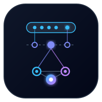

<p align="center">
  
</p>

<h1 align="center">AgentMem</h1>

<p align="center">
  Hierarchical long-term memory engine and visual memory inspector for autonomous AI agents.
</p>

<p align="center">
  <a href="#overview">Overview</a> •
  <a href="#core-architecture">Architecture</a> •
  <a href="#quickstart">Quickstart</a> •
  <a href="#sdk-usage">SDK Usage</a> •
  <a href="#cli-reference">CLI</a> •
  <a href="#embedded-studio">Web Studio</a> •
  <a href="#license">License</a>
</p>

---

## Overview

AgentMem gives autonomous agents structured memory that persists across sessions and conversations. Instead of dumping raw chat logs into vector databases, AgentMem separates memory into three distinct tiers:

1. **Working Memory:** High-speed in-context conversation buffer with dynamic token budget trimming.
2. **Episodic Memory:** Chronological session summaries enriched with timestamps, task outcomes, and importance weights.
3. **Semantic Knowledge Graph:** Normalized entity-relation-entity triplets stored in embedded SQLite with recursive CTE traversal.

The background consolidation daemon applies an Ebbinghaus decay curve to prune conversational noise, merges related entities, and updates conflicting preferences. An embedded React 19 Web Studio runs locally on port 50094 to inspect the graph, review recall scores, and edit stored facts.

---

## Core Architecture

```
+------------------------------------------------------------------------+
|                          AgentMem Core Engine                          |
+------------------------------------------------------------------------+
|  Ingestion & Fact Extraction Pipeline                                  |
|    * Entity & Triplet Extractor (Subject, Predicate, Object)           |
|    * Contradiction Resolver (Supersedes conflicting facts)             |
|    * Importance Scorer (Assigns retention weight 0.0 - 1.0)            |
+------------------------------------------------------------------------+
|  Hierarchical Storage Engine (Embedded SQLite)                         |
|    * Working Memory: Active session buffer cache                       |
|    * Episodic Store: Time-series session narrative summaries           |
|    * Semantic Store: Relational Graph (Entities, Relations, Values)    |
|    * Vector Store: Fast in-memory / SQLite vector cosine search        |
+------------------------------------------------------------------------+
|  Consolidation & Decay Daemon                                          |
|    * Recency & Frequency Scoring (Ebbinghaus decay curve)              |
|    * Noise Pruning (Purges low-importance ephemeral chatter)           |
|    * Entity Graph Deduplication & Alias Merging                        |
+------------------------------------------------------------------------+
|  Hybrid Recall & Context Synthesizer                                   |
|    * Combined Vector + FTS5 Full-Text + Graph Neighbor Traversal       |
|    * Formats compact Markdown prompt injection: <agent_memory>...      |
+------------------------------------------------------------------------+
                                    |
                                    v
                 [ React 19 Memory Studio (Port 50094) ]
```

---

## Quickstart

### Installation

Clone and install dependencies:

```bash
git clone https://github.com/alexandrmotologa/agentmem.git
cd agentmem
npm install
npm run build
```

Run tests:

```bash
npm test
```

Start the interactive Web Studio:

```bash
npm run studio
```

---

## SDK Usage

```typescript
import { AgentMemory } from 'agentmem';

// Initialize the memory engine with local SQLite database
const memory = new AgentMemory({
  dbPath: './agentmem.db',
  decayIntervalHours: 24,
});

await memory.initialize();

// Ingest a completed conversation turn or session
await memory.ingestEpisode({
  sessionId: 'session_101',
  turns: [
    { role: 'user', content: 'Our production database is PostgreSQL 16 on AWS Aurora.' },
    { role: 'assistant', content: 'Got it. I will keep that infrastructure in mind.' },
    { role: 'user', content: 'Always format database migrations as pure SQL without ORMs.' }
  ]
});

// Query memory before generating the next agent response
const recallResult = await memory.recall({
  query: 'How should I structure the new user migration script?',
  maxTokens: 500,
  includeEpisodes: true,
  graphHops: 2
});

console.log(recallResult.systemPromptSnippet);
// Output ready for prompt injection:
// <agent_memory>
// [Semantic Knowledge Graph]
// - Database: PostgreSQL 16 (deployed_on: AWS Aurora)
// - Constraint: format database migrations as pure SQL without ORMs
// [Relevant Past Episodes]
// - Session session_101: Configured database constraints and migration policies.
// </agent_memory>
```

---

## CLI Reference

AgentMem includes a command-line interface for maintenance, querying, and launching the Web Studio:

```bash
# Launch the visual knowledge graph web studio
agentmem studio --db ./agentmem.db --port 50094

# Query memory directly from the terminal
agentmem query "What database constraints does the project have?" --db ./agentmem.db

# Run consolidation and decay pruning manually
agentmem consolidate --db ./agentmem.db

# Ingest conversation trace from a JSON file
agentmem ingest ./examples/agent-conversation-trace.json --db ./agentmem.db

# Display memory statistics and node counts
agentmem stats --db ./agentmem.db
```

---

## Embedded Studio

AgentMem embeds a React 19 Web Studio for real-time memory inspection:

* **Force-directed Knowledge Graph:** Interactive 2D visualization of entities, properties, and relation edges.
* **Episodic Timeline:** Chronological narrative milestones organized by session.
* **Recall Simulator:** Test queries and inspect hybrid search weights (Vector, FTS5, Graph traversal) before deploying prompts.
* **Memory Editor:** Create, update, or remove entity nodes and relations directly.

---

## License

MIT License. See [LICENSE](LICENSE) for details.
